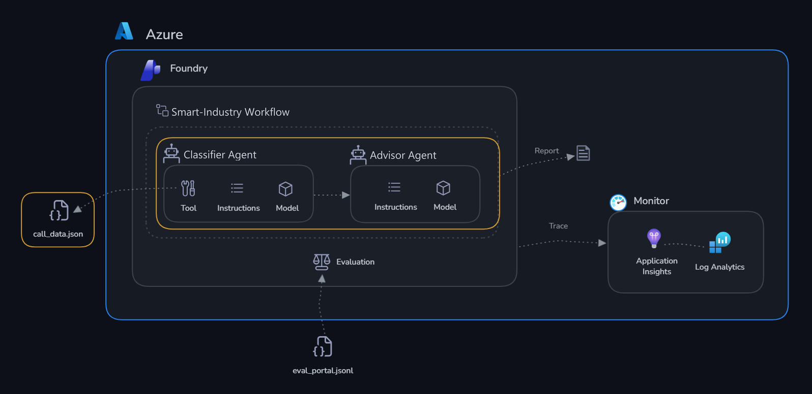
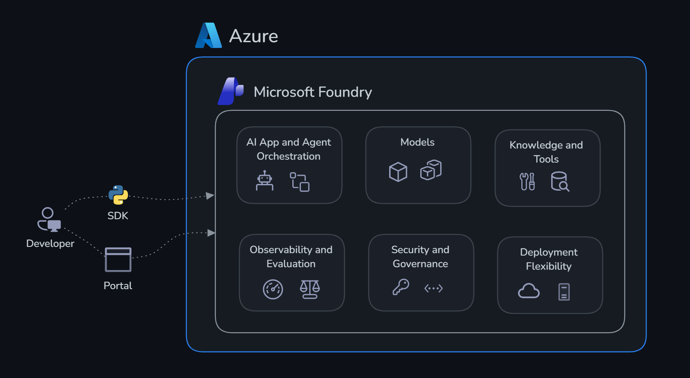
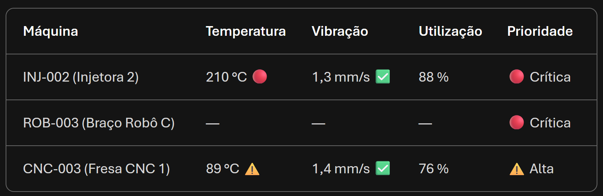

# Desafio 1: Construir agentes

Tempo: ~35 minutos

## Objetivos

Ao final deste desafio, você terá:

- ✅ Um **Agente Classificador** que compara a telemetria de cada máquina com os limites dela e informa a prioridade
- ✅ Um **Agente Advisor** que transforma esses achados em ações de manutenção, urgência e escalonamento
- ✅ Uma **ferramenta OpenAPI** anexada ao Classificador para que ele leia os dados reais da planta
- ✅ Uma ferramenta **File Search** anexada ao Advisor para que ele consulte procedimentos, SLAs e o histórico de manutenção



## Contexto

A Smart Industry monitora 16 máquinas da Unidade Industrial SP: tornos e fresas CNC, robôs, esteiras, empilhadeiras, injetoras, prensa e célula de solda. Cada máquina traz telemetria (`temp` em °C, `vib` em mm/s e `usage` em %), parâmetros (`tempLimit`, `vibLimit` e `mode`), o indicador `commLost` e um `status` (`online`, `alert` ou `offline`). Os limites são **específicos de cada máquina**: uma leitura segura em uma injetora pode ser uma emergência em uma esteira. Seus agentes precisam:

1. **Classificação**: comparar cada leitura com os limites da própria máquina e marcar 🔴 crítico, ⚠️ alto ou ✅ baixo
2. **Aconselhamento**: com base nessa classificação, recomendar ações de manutenção, urgência e escalonamento — consultando os documentos internos de procedimentos, SLAs e histórico de manutenção

---

## Conceitos antes de clicar

### O que é um agente?

Um agente no Microsoft Foundry é um assistente de IA persistente, baseado em um modelo de linguagem grande. Diferente de uma única mensagem de chat, um agente mantém uma **conversa**, pode **chamar ferramentas por conta própria** e **preserva o contexto** entre os turnos. Você o configura com:

- Um **nome** e um **modelo** (o que você implantou no Desafio 0)
- **Instruções**: um prompt de sistema que define o papel e os limites do agente
- Uma ou mais **ferramentas** que ele pode chamar quando precisa de informações além do que aprendeu no treinamento

Os agentes são salvos no seu projeto. Eles aparecem em **Agents**, e você pode editá-los, versioná-los e testá-los a qualquer momento.

### O que são ferramentas?

As ferramentas ampliam o agente além da geração de texto. Quando o modelo decide que precisa de uma informação que não tem, ele emite uma **chamada de ferramenta**. O Foundry executa a ferramenta e devolve o resultado ao modelo, que continua o raciocínio até produzir a resposta final. Você nunca escreve a lógica de decisão: o modelo lê o **nome e a descrição** da ferramenta e decide sozinho.

> [!IMPORTANT]
> A **descrição** da ferramenta é a única coisa que o modelo usa para decidir se deve chamá-la. Uma descrição vaga é o motivo mais comum de um agente ignorar uma ferramenta que deveria ter usado.

### Quais ferramentas você pode adicionar?

| Tipo de ferramenta | O que faz | Uso neste laboratório |
|--------------------|-----------|-----------------------|
| **OpenAPI** | Chama uma API REST descrita por um arquivo de schema | Leitura dos dados reais da planta |
| **Azure AI Search** | Consulta um índice de busca criado sobre seus documentos (RAG) | Não é usada aqui — o File Search cobre o caso com arquivos enviados diretamente |
| **Code Interpreter** | Permite que o agente escreva e execute Python em um sandbox | Não é usada aqui — experimente após o laboratório |
| **File Search** | Pesquisa arquivos enviados ao agente (RAG sobre um vector store gerenciado pelo Foundry) | Consulta de procedimentos, SLAs e histórico de manutenção pelo Advisor |



---

## Os dados da planta e a API

O snapshot da planta contém 16 máquinas, cada uma com telemetria, parâmetros, status, motivos e alertas. O resumo armazenado tem 11 máquinas `online`, 4 em `alert` (CNC-003, CVY-003, FKL-003 e INJ-002) e 1 `offline` (ROB-003).

Uma API REST somente leitura serve esse conjunto de dados:

| Método | Rota | `operationId` | Resultado |
|---|---|---|---|
| GET | `/plant/status` | `get_plant_status` | Resumo da planta: contagem por status, IDs em alerta e offline, e unidades |
| GET | `/machines` | `list_machines` | Todas as máquinas; aceita os filtros opcionais `status` e `type` |
| GET | `/machines/{machine_id}` | `get_machine` | Uma máquina (por exemplo `CNC-003`) |
| GET | `/docs` | — | Documentação interativa da API |

A API já está implantada e em execução — você não precisa hospedá-la.

> [!IMPORTANT]
> **Peça a URL da API ao seu facilitador.** O arquivo de schema contém uma URL de exemplo (`/`), que não é um deployment real. Confirme a URL atual e abra `<url-da-api>/plant/status` no navegador para verificar se ela responde com JSON.

O arquivo de schema que você vai enviar é o [openapi.json](../api-data/openapi.json), nesta pasta. Baixe-o para o seu computador agora — o portal pede que você procure um arquivo local.

---

## Etapa 1 — Criar o Agente Classificador

1. Abra [ai.azure.com/nextgen](https://ai.azure.com/nextgen) e selecione o seu projeto.
2. Na navegação superior, selecione **Build** e depois **Agents** na barra lateral esquerda.
3. Selecione **+ New agent**.
4. Defina o **Agent name** como:

   ```text
   1-classifier-agent
   ```

5. Defina o **Model** como a implantação que você criou no Desafio 0.
6. Cole o texto a seguir na caixa **Instructions**, exatamente como está:

   ```text
   ## Propósito
   - Você é um assistente de IA da Smart Industry que ajuda o usuário a classificar a condição das máquinas da Unidade Industrial SP (CNC, robôs, esteiras, empilhadeiras, injetoras, prensa e célula de solda).

   ## Contexto
   - Carregue os dados por meio das ferramentas: use `list_machines` para várias máquinas (ou para todas), `get_machine` para um ID específico (ex.: CNC-003) e `get_plant_status` para o resumo da planta.
   - Cada máquina traz `telemetry` (temp em °C, vib em mm/s, usage em %), `params` (tempLimit em °C, vibLimit em mm/s, mode), `commLost` e `status` (online, alert, offline).
   - Os limites são específicos de cada máquina. Use sempre `params.tempLimit` e `params.vibLimit` da própria máquina; nunca use limites genéricos.

   ## Regras de Classificação
   - Temperatura:
     - 🔴 crítico: temp >= tempLimit × 1,05
     - ⚠️ alto: temp >= tempLimit e abaixo de tempLimit × 1,05
     - ✅ baixo: temp < tempLimit
   - Vibração:
     - ⚠️ alto: vib >= vibLimit
     - ✅ baixo: vib < vibLimit
   - Utilização (usage): não há limite definido; exiba somente o valor, sem símbolo.
   - Máquina offline (`commLost` = true ou `params.mode` = off): a telemetria não é confiável. Exiba "—" nas métricas e prioridade 🔴 (sem comunicação).
   - Máquina com `params.mode` = paused: prioridade ⚠️ (pausada), mesmo sem violação de limite.

   ## Formato de Saída
   - SOMENTE a tabela de resumo da classificação, sem texto antes ou depois.
   - Linhas = uma por máquina (ID e nome).
   - Colunas = Máquina | Temperatura | Vibração | Utilização | Prioridade.
   - Em cada célula de métrica, mostre o valor com a unidade e o símbolo (ex.: `89 °C ⚠️`).
   - Prioridade = o pior símbolo entre as métricas: 🔴 Crítica, ⚠️ Alta, ✅ Baixa.
   - Ordene das prioridades mais altas para as mais baixas.

   ## Escopo
   - Antes de responder, verifique se a solicitação está relacionada a este Propósito.
   - Se estiver no escopo: continue a conversa.
   - Se estiver fora do escopo: não responda ao conteúdo da solicitação. Apenas explique o seu propósito.

   ## Guardrails
   - Não crie dados de telemetria.
   - Não recomende nada.
   - Se faltarem dados-chave, faça perguntas de acompanhamento precisas.
   ```

7. **Salve** o agente.
8. Abra o **Playground** do agente (o painel de chat ao lado da configuração do agente).
9. Envie este prompt para testar as regras sem a ferramenta — as leituras e os limites estão no próprio texto:

   ```text
   Classifique as máquinas a seguir:
   - CNC-003 (Fresa CNC 1): temp 89 °C (tempLimit 85), vib 1,4 mm/s (vibLimit 1,5), usage 76 %, mode auto, commLost false
   - INJ-002 (Injetora 2): temp 210 °C (tempLimit 195), vib 1,3 mm/s (vibLimit 1,5), usage 88 %, mode auto, commLost false
   - ROB-003 (Braço Robô C): commLost true, mode auto
   ```

10. Veja os resultados retornado pelo agente


> [!NOTE]
> Observe que as regras dependem de `params.tempLimit` e `params.vibLimit`. Sem a ferramenta, o agente só consegue classificar leituras que você cole no prompt **junto com telemetria e seus limites**. Anexar a ferramenta na próxima etapa é o que o conecta aos dados reais da planta.
>
> Observe também **"Não recomende nada"** — isso mantém a classificação separada do aconselhamento. Essa separação é a razão de existirem dois agentes.

---

## Etapa 2 — Anexar a ferramenta OpenAPI ao Classificador

1. Com o `1-classifier-agent` aberto, localize a seção **Tools** e selecione **+ Add**.
2. No seletor de ferramentas, abra a aba **Custom** e escolha **OpenAPI 3.0 specified tool**.
3. Preencha:

   | Campo | Valor |
   |---|---|
   | **Name** | `plant_api` |
   | **Description** | `Lê os dados reais das máquinas da Smart Industry: telemetria, limites por máquina, status, motivos e alertas, além do resumo da planta.` |
   | **Authentication method** | **Anonymous** |

4. Na etapa **Define schema**, selecione **Upload file** e escolha o arquivo [openapi.json](./openapi.json) que você baixou.
5. Confira a URL de `servers` exibida na prévia do schema. Se ela não for a URL informada pelo facilitador, edite-a na prévia antes de continuar.
6. Selecione **Create tool**.
7. Confirme que a ferramenta lista as três operações `GET`: `get_plant_status`, `list_machines` e `get_machine`.

<!-- TODO: screenshot — Add tool > Custom > OpenAPI 3.0 specified tool, etapa de upload do schema -->

---

## Etapa 3 — Testar o Classificador

1. Abra o **Playground** do agente (o painel de chat ao lado da configuração do agente).
2. Agora teste a **ferramenta**. Envie:

   ```text
   Classifique todas as máquinas da planta usando os dados atuais.
   ```

   O agente deve chamar `list_machines` em vez de pedir as leituras. Expanda a entrada da chamada de ferramenta no chat para ver a solicitação feita e o JSON recebido. O resultado deve mostrar **16 máquinas: 2 críticas (INJ-002 e ROB-003), 3 altas (CNC-003, CVY-003 e FKL-003) e 11 baixas**.

3. Teste também uma máquina específica: `Classifique a máquina FKL-003.` O agente deve chamar `get_machine`.

> [!TIP]
> Se o agente pedir as leituras em vez de chamar a ferramenta, a descrição da ferramenta está vaga demais ou a URL da API está inacessível. Abra `<url-da-api>/machines` no navegador para confirmar que a API responde e depois torne a descrição mais explícita.

---

## Etapa 4 — Criar o Agente Advisor

1. Volte para **Build** → **Agents** → **+ New agent**.
2. Defina o **Agent name** como:

   ```text
   2-advisor-agent
   ```

3. Defina o **Model** como a mesma implantação.
4. Cole o texto a seguir na caixa **Instructions**, exatamente como está:

   ```text
   ## Propósito
   Transformar os achados estruturados de um classificador em ações de manutenção, urgência e orientações de escalonamento para a Smart Industry.

   ## Contexto
   - Use os achados do classificador fornecidos na solicitação como única fonte de leituras, limites e prioridades.
   - Use a ferramenta de busca em arquivos para consultar o Manual de Procedimentos de Manutenção, o Diretório de Escalonamento e SLAs e o Histórico de Telemetria e Manutenção. Fundamente ações, prazos, responsáveis e histórico da máquina nesses documentos e cite o nome do documento e a seção.
   - Se a informação não estiver nos documentos, diga que não a encontrou. Não invente procedimentos, prazos ou contatos.

   ## Regras de Recomendação
   - Para temperatura crítica, exija parada controlada da máquina conforme o procedimento do local e escalonamento imediato para a manutenção.
   - Para máquinas offline, oriente a verificação do gateway/sensor e das condições físicas antes de considerar a telemetria confiável.
   - Para prioridade alta, recomende inspeção ou manutenção planejada.
   - Para máquinas com prioridade baixa, continue o monitoramento.

   ## Formato de Saída
   - Para cada máquina, retorne Prioridade, Urgência, Evidências recebidas, Ação recomendada, Escalonamento e Fonte.
   - Use exatamente: 🔴 crítica, ⚠️ alta, ✅ baixa.

   ## Escopo
   - Antes de responder, verifique se a solicitação está relacionada a este Propósito.
   - Se estiver no escopo: continue a conversa.
   - Se estiver fora do escopo: não responda ao conteúdo da solicitação. Apenas explique o seu propósito.

   ## Guardrails
   - Não invente, altere ou reclassifique leituras ou limites.
   - Não afirme que uma parada ocorreu.
   - Não crie dados de telemetria.
   - Se faltarem dados-chave, faça perguntas de acompanhamento precisas.
   ```

5. **Salve** o agente. A ferramenta de busca em arquivos será anexada na próxima etapa.

---

## Etapa 5 — Anexar a ferramenta File Search ao Advisor

Nesta etapa você envia os documentos internos da planta para o Advisor. O Foundry cria um **vector store** com o conteúdo dos arquivos, e o agente passa a buscar trechos relevantes (**RAG**) e a citá-los, em vez de depender apenas do que o modelo aprendeu no treinamento.

Os arquivos estão na pasta [advisor-context](./advisor-context):

| Arquivo | Conteúdo |
|---|---|
| `SmartIndustry_Manual_Procedimentos_Manutencao.pdf` | Limites por classe de equipamento e procedimentos para temperatura crítica, máquina offline, prioridade alta e baixa |
| `SmartIndustry_Diretorio_Escalonamento_SLA.pdf` | SLAs por prioridade, equipe de plantão e fluxo de escalonamento crítico |
| `SmartIndustry_Historico_Telemetria_Manutencao.pdf` | Histórico de alertas e manutenções de INJ-002, ROB-003, CNC-003 e CVY-003 |

> [!NOTE]
> Os documentos são sintéticos, criados para demonstração. Nomes, ramais e incidentes são fictícios.

Baixe os três PDFs para o seu computador e depois:

1. Com o `2-advisor-agent` aberto, localize a seção **Tools** e selecione **+ Add**.
2. No seletor de ferramentas, escolha **File search**.
3. Selecione **Upload files** (ou **Add files**) e escolha os três PDFs da pasta `advisor-context`.
4. Confirme o envio e aguarde o processamento: os arquivos devem aparecer com o status **Completed** (ou equivalente) no vector store.
5. Selecione **Attach** (ou **Add tool**) e **salve** o agente.
6. Confirme que **File search** aparece na lista de **Tools** do agente com os três arquivos.

<!-- TODO: screenshot — Add tool > File search > upload dos três PDFs de advisor-context -->

> [!TIP]
> O File Search só indexa o que foi enviado. Se o Advisor responder que não encontrou uma informação que está nos PDFs, confira se os três arquivos terminaram de ser processados e se as instruções mencionam a busca nos documentos.

---

## Etapa 6 — Testar o Advisor

Abra o playground do Advisor e envie os achados do Classificador como contexto:

```text
Achados do classificador:
- INJ-002 (Injetora 2): 🔴 Crítica — temperatura 210 °C, limite 195 °C; vibração 1,3 mm/s (limite 1,5) ✅
- ROB-003 (Braço Robô C): 🔴 Crítica — sem comunicação; telemetria não confiável
- CNC-003 (Fresa CNC 1): ⚠️ Alta — temperatura 89 °C, limite 85 °C
- CVY-003 (Esteira 3): ⚠️ Alta — vibração 0,7 mm/s, limite 0,6 mm/s

O que a equipe de manutenção deve fazer hoje?
```

Verifique a resposta:

- **INJ-002** deve gerar **parada controlada** e **escalonamento imediato** (Manual, seção 3), com chamado **P1** e resposta imediata em até 15 minutos (Diretório de Escalonamento, seção 1)
- **ROB-003** deve gerar a **verificação do gateway/sensor** antes de confiar na telemetria (Manual, seção 4), citando o histórico de falhas de comunicação e o gateway `GW-ROB-07` (Histórico, seção 2)
- **CNC-003** e **CVY-003** devem gerar **inspeção planejada** em até 24 horas (Manual, seção 5), com base no histórico de alertas recorrentes
- Cada recomendação deve trazer o campo **Fonte** com o nome do documento
- Nenhuma leitura ou limite novo deve ser inventado, e a resposta não deve afirmar que uma parada já ocorreu

Expanda a chamada de ferramenta no chat para ver os trechos que o File Search retornou.

Agora confirme que o Advisor realmente consulta os documentos. Envie, uma por vez:

```text
Quem é o responsável de plantão pela área de Injeção e Robótica no turno das 06h às 14h, e qual o ramal?
```

Esperado: Mariana Alves, Supervisora de Manutenção, ramal 4021, com a fonte `SmartIndustry_Diretorio_Escalonamento_SLA.pdf`.

```text
A INJ-002 já teve alertas de temperatura antes? Quais ações foram tomadas?
```

Esperado: alertas de 14/03/2026 (191 °C) e 02/06/2026 (193 °C), com inspeção das resistências e troca do termopar da zona 3, e a referência ao `SmartIndustry_Historico_Telemetria_Manutencao.pdf`.

```text
Qual o procedimento de uma máquina com temperatura crítica se o supervisor não responder em 15 minutos?
```

Esperado: parada controlada, chamado P1, e escalonamento ao gerente de planta se não houver resposta em 15 minutos (Diretório de Escalonamento, seção 3).

> [!TIP]
> Se o Advisor responder sem citar nenhum documento, a ferramenta de busca não foi chamada. Confirme que o **File search** está listado em **Tools** e peça explicitamente: *"Consulte os documentos e cite a fonte."*

---

## Critérios de sucesso

- [ ] Os dois agentes (`1-classifier-agent` e `2-advisor-agent`) aparecem no seu projeto em **Agents**
- [ ] O Classificador retorna somente uma tabela com temperatura, vibração, utilização e prioridade (🔴 / ⚠️ / ✅)
- [ ] O Classificador chama a ferramenta `plant_api` e identifica 2 máquinas críticas, 3 altas e 11 baixas
- [ ] O Advisor tem a ferramenta **File search** com os três PDFs de `advisor-context`
- [ ] O Advisor recomenda parada controlada e escalonamento imediato para temperatura crítica
- [ ] O Advisor recomenda verificar o gateway/sensor para máquina offline
- [ ] O Advisor cita o documento de origem (procedimento, SLA ou histórico) nas recomendações
- [ ] O Advisor não inventa leituras, procedimentos, prazos ou contatos

Próximo: [Desafio 2 — Monitor](../challenge-2-monitor/README.md)