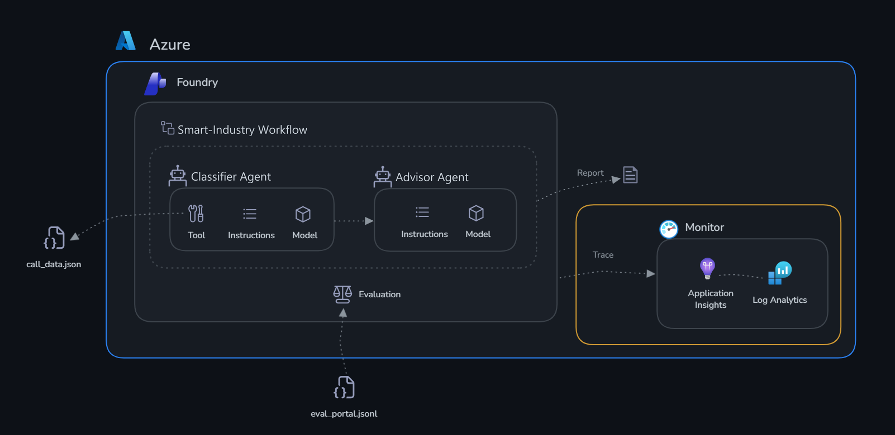
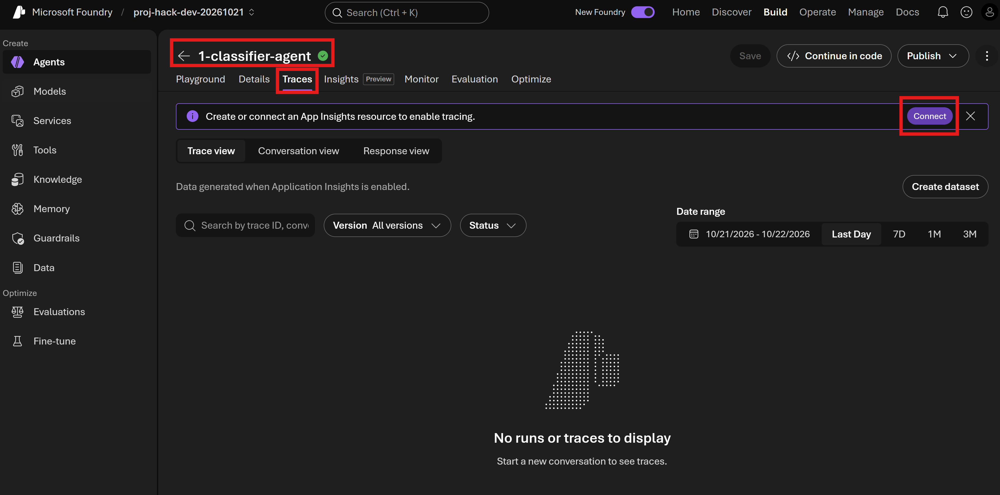

# Desafio 2: Monitorar com o Application Insights

Tempo: ~20 minutos

## Objetivos

Ao final deste desafio, você terá:

- ✅ Traces de GenAI dos seus agentes visíveis no portal do Foundry
- ✅ As interações dos agentes visíveis como traces no Application Insights
- ✅ Uma noção clara de como depurar o comportamento de um agente em produção



## Contexto

Seus agentes funcionam — mas como saber se eles funcionam **bem**? E se o classificador marcar como ✅ baixa uma máquina que está em temperatura crítica? E se as recomendações do advisor demorarem demais para serem geradas durante o pico de produção?

O **Application Insights** com **tracing de GenAI** oferece:

- Um trace completo de cada interação do agente (mensagem do usuário → chamada ao modelo → chamadas de ferramenta → resposta)
- O uso de tokens por solicitação
- O detalhamento da latência (rede, inferência do modelo e execução da ferramenta)
- Rastreamento de erros e alertas

## Por que monitorar?

Agentes de IA se comportam de forma diferente de um software tradicional. Uma API convencional retorna os dados corretos ou gera um erro — você pode testá-la de forma determinística. A saída de um agente é probabilística: a mesma entrada pode produzir respostas sutilmente diferentes a cada execução, chamadas de ferramenta podem ter sucesso e ainda assim retornar dados inesperados, e as falhas podem ser silenciosas (o agente responde com confiança, mas de forma incorreta). Sem observabilidade, esses problemas permanecem invisíveis até que um usuário os reporte.

O monitoramento cumpre três funções críticas para agentes de IA:

- **Confiabilidade** — Detectar quando os agentes deixam de funcionar (chamadas de ferramenta com falha, timeouts e respostas vazias) antes dos usuários
- **Desempenho** — Acompanhar a latência e o uso de tokens ao longo do tempo, detectar regressões ao atualizar um prompt de sistema e dimensionar corretamente as implantações para ter eficiência de custo
- **Depuração** — Quando algo dá errado, os traces distribuídos fornecem o registro completo do raciocínio do modelo, das ferramentas chamadas, do que elas retornaram e de exatamente onde a cadeia parou

Em sistemas de IA em produção, o monitoramento é a base que torna a melhoria possível. Você não consegue corrigir o que não consegue ver.

Especificamente para a Smart Industry: uma injetora com temperatura crítica (INJ-002) classificada como normal significa que um equipamento pode continuar operando acima do limite sem que ninguém seja avisado. Um pico de latência durante o turno de produção pode atrasar o escalonamento para a manutenção. Sem traces, você nunca saberia qual chamada de ferramenta (`list_machines`, `get_machine` ou `get_plant_status`) ou qual etapa de raciocínio do modelo causou o problema — nem mesmo que ele ocorreu.

## Portal do Foundry ou Application Insights?

O Microsoft Foundry oferece duas formas de monitorar agentes, e este desafio usa as duas, sem escrever código. O **portal do Foundry** ([ai.azure.com/nextgen](https://ai.azure.com/nextgen)) tem uma visão integrada de **Traces**, na qual você navega pelas interações do agente, inspeciona spans individuais e vê o uso de tokens e a latência. O **Application Insights** (pelo portal do Azure) permite uma análise mais profunda: consultas Kusto, dashboards personalizados e regras de alerta.

Você vai gerar tráfego usando os agentes criados no Desafio 1 e depois explorar os mesmos dados em cada uma das opções.

## Conectar o Application Insights ao portal

Abra o [portal do Microsoft Foundry](https://ai.azure.com/nextgen), acesse seu projeto, abra o agente `1-classifier-agent` e selecione a aba **Traces**.

Ao aparecer o banner **"Create or connect an App Insights resource to enable tracing"**, clique: **Connect**.



## Gerar traces

Antes de explorar, gere algumas interações. No **Playground** de cada agente, envie:

1. Para o `1-classifier-agent`:

   ```text
   Classifique todas as máquinas da planta usando os dados atuais.
   ```

   Confirme que o agente chamou a ferramenta `plant_api` (`list_machines`).

2. Para o `2-advisor-agent`:

   ```text
   Achados do classificador:
   - INJ-002 (Injetora 2): 🔴 Crítica — temperatura 210 °C, limite 195 °C
   - CNC-003 (Fresa CNC 1): ⚠️ Alta — temperatura 89 °C, limite 85 °C

   O que a equipe de manutenção deve fazer hoje?
   ```

> [!NOTE]
> Os traces podem levar de 1 a 2 minutos para aparecer. Se a lista estiver vazia, aguarde um momento e atualize a página.

---

## Etapa 1 — Portal do Microsoft Foundry

1. Abra o [portal do Microsoft Foundry](https://ai.azure.com/nextgen) → abra seu projeto.
2. Selecione **Build** → **Agents** → `1-classifier-agent` → **Traces**.

   - **Painel Traces** — Mostra cada execução do agente como uma linha, com o ID da conversa, o ID do trace, o ID da resposta, o status, o horário de criação, a duração, os tokens de entrada/saída, o custo estimado, os resultados de avaliação e a versão do agente. Use a caixa de pesquisa e os filtros **Version**, **Status** e **Date range** para refinar os resultados, alterne entre **Trace view**, **Conversation view** e **Response view**, ou selecione **Create dataset** para transformar esses traces em um dataset de avaliação.

3. Você verá uma lista de traces recentes — selecione qualquer linha para abri-la.
4. Dentro de um trace, você pode ver:
   - Cada **turno do agente** como um span (entrada → saída)
   - As **chamadas de ferramenta** (`list_machines`, `get_machine` e `get_plant_status`) como spans filhos, com entradas e saídas
   - O **uso de tokens** e a **latência** de cada span
  
5. Use a **visão de linha do tempo** para encontrar spans lentos e o **painel de detalhes** para inspecionar mensagens individuais.
6. Volte ao agente e selecione **Monitor**.

   - **Painel Monitor** — A aba **Overview** traz um resumo rápido de integridade, com **Operational metrics** (custo estimado e uso total de tokens) e os cards **Evaluations**, **Scheduled evaluations** e **Scheduled red teaming run issues**. Abaixo, os gráficos de **Operational metrics** mostram **Agent runs** (quantas vezes o agente foi chamado) e **Runs and token metrics** (chamadas versus tokens consumidos) no período selecionado. Use a aba **Tools**, os filtros de data, **Settings** ou **Open in Azure Monitor** para uma análise mais profunda.

7. Repita os passos 2 a 6 para o `2-advisor-agent`. Observe que as chamadas de ferramenta dele são buscas do **File search** nos documentos de `advisor-context`, e não chamadas à `plant_api`.

## Etapa 2 — Application Insights

1. Abra o [portal do Azure](https://portal.azure.com) → pesquise por **Application Insights** → abra `insights-<suffix>`.
2. Na barra lateral esquerda → **Investigate** → **Search**.
3. Defina o intervalo de tempo como **Last 30 minutes** e selecione **Search** — você verá eventos de trace individuais.
4. Procure traces em que seus agentes foram invocados. Você pode inspecionar o carimbo de data/hora, o ID da operação e o conteúdo da mensagem para confirmar que as chamadas chegaram ao modelo.
5. Selecione uma instância do `1-classifier-agent`. Você verá o **trace de transação de ponta a ponta**, mostrando:
   - A conversa completa do agente (entrada do usuário → chamada à ferramenta `plant_api` → resposta com a tabela de classificação)
   - Os spans aninhados de cada chamada ao modelo, com o detalhamento da latência
   - O prompt de sistema exato e o raciocínio gerado pelo agente para chegar à conclusão
   - Os detalhes do recurso em que o agente foi executado
   - Qualquer bloqueio de filtro de conteúdo que tenha violado os padrões de IA Responsável
   - Essa visão permite inspecionar exatamente o que o agente "viu" e "raciocinou", para entender classificações incorretas ou problemas de desempenho
6. Na barra lateral esquerda → **Investigate** → **Agents (preview)** para abrir o dashboard operacional focado em agentes.
   - Use os filtros **Time range** e **Agent** no topo para refinar a visão, alterne entre as abas **Dashboard** e **All agents**, ou selecione **Explore in Grafana** para uma análise mais profunda.
   - **Agent operational metrics**:
     - **Agent Runs** — total de invocações por agente (por exemplo, `1-classifier-agent` e `2-advisor-agent`). Selecione **View Traces with Agent Runs** para acessar os traces correspondentes.
     - **Gen AI Errors** — mostra os traces com erros de GenAI na janela selecionada; uma marca verde significa que nenhum foi encontrado.
     - **Tool Calls** — uma tabela com cada ferramenta (por exemplo, `list_machines`), com a contagem de erros, a duração média e o número de chamadas, para identificar ferramentas lentas ou com falha.
     - **Models** — um detalhamento por modelo, com erros, duração média e número de chamadas.
   - **Token consumption**:
     - **Token Consumption by Model** — total de tokens consumidos por modelo.
     - **Input vs Output Tokens** — total de tokens de entrada versus saída ao longo do tempo, útil para acompanhar os fatores de custo.

---

## Critérios de sucesso

- [ ] O Application Insights está conectado ao projeto e os traces dos dois agentes aparecem
- [ ] Você consegue navegar pelos traces do agente na visão **Traces** do portal do Foundry e abrir uma conversa
- [ ] Você enxerga a chamada à ferramenta `plant_api` (solicitação e resposta) dentro de um trace do Classificador
- [ ] Você consegue ler o painel **Monitor** (execuções do agente, uso de tokens e custo estimado)
- [ ] Você vê pelo menos um trace de agente no Application Insights e abre seu trace de transação de ponta a ponta
- [ ] Você usa o dashboard **Agents (preview)** para ver execuções de agentes, chamadas de ferramenta, modelos e consumo de tokens
- [ ] Você entende onde investigar quando um agente se comporta mal

Próximo: [Desafio 3 — Evaluation](../challenge-3-evaluate/README.md)
