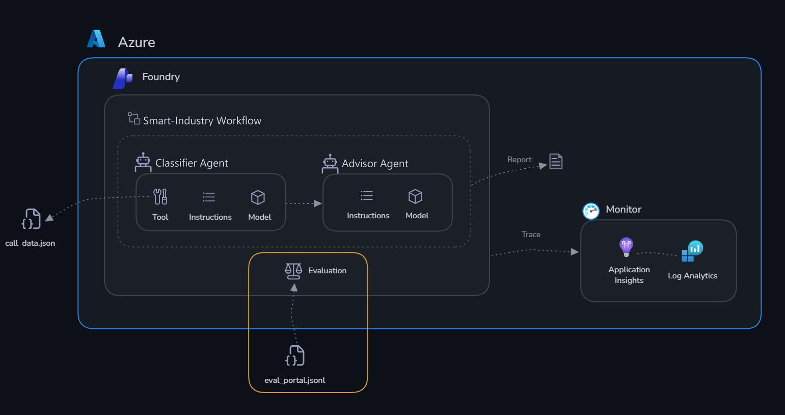

# Desafio 3: Avaliar

Tempo: ~30 minutos

## Objetivos

Ao final deste desafio, você terá:

- ✅ Executado uma avaliação sistemática do seu Classificador com um dataset de 10 casos de teste
- ✅ Usado avaliadores integrados (coherence e fluency) para medir a qualidade
- ✅ Interpretado os resultados no nível agregado e por linha
- ✅ Entendido como a avaliação se encaixa em um processo de release



## Contexto

O monitoramento mostra **o que está acontecendo** (latência, erros, uso de tokens). A avaliação mostra **se as classificações realmente são boas**.

Você tem um dataset com 10 casos de teste. Cada um é um cenário de máquina, com telemetria e limites, junto com a classificação esperada. Você vai executar o Classificador nos 10 casos e pontuar os resultados com avaliadores LLM-as-judge.

## Por que evaluation?

O monitoramento diz que seus agentes estão *funcionando* — a avaliação diz se eles estão fazendo a *coisa certa*. São perguntas diferentes.

O monitoramento captura **sinais operacionais**: latência, contagem de tokens, taxas de erro e disponibilidade. Eles dizem *como* o sistema se comporta mecanicamente. A avaliação captura **sinais de qualidade**: as saídas estão corretas, relevantes, coerentes e consistentes com o que você esperava? Eles dizem *se* o sistema está cumprindo seu propósito.

Sem uma avaliação sistemática, você depende de verificações pontuais — ler algumas respostas e julgá-las por impressão. Isso não escala, não é repetível e não detecta uma regressão quando você edita um prompt ou troca de modelo. Uma avaliação oferece uma linha de base mensurável: um número que você pode acompanhar ao longo do tempo e comparar entre versões.

A avaliação também detecta problemas que o monitoramento não enxerga. Um agente que sempre responde rápido e sem erros, mas lê um limite de forma errada, parece perfeitamente saudável no dashboard de monitoramento.

As avaliações devem ser executadas:

- **Antes da implantação** — para estabelecer uma linha de base de qualidade e condicionar um release a uma pontuação mínima
- **Após qualquer mudança** — nas instruções, no modelo, nas ferramentas ou nos dados de grounding
- **Em uma agenda** — para detectar desvios (drift) conforme o modelo subjacente é atualizado

Especificamente para a Smart Industry: um agente que classifica a INJ-002 — temperatura de 210 °C contra um limite de 195 °C — como alta em vez de crítica atrasa o escalonamento para a manutenção. Ou um que usa um limite genérico e marca a WLD-001 (320 °C, limite de 380 °C) como crítica gera um alarme falso. O monitoramento vê uma resposta rápida e bem-sucedida. Somente a avaliação detecta o erro.

---

## O dataset de avaliação

O dataset é o [eval_portal.jsonl](./eval_portal.jsonl), nesta pasta. Ele contém 10 linhas, e cada linha tem:

- `query` — o cenário da máquina enviado ao agente, com telemetria e limites
- `ground_truth` — a classificação esperada, com a prioridade, o status de cada métrica e as anomalias

Os 10 casos cobrem máquinas normais, em alerta e críticas, violações de uma ou de várias métricas, uma máquina offline (ROB-003), uma máquina pausada (FKL-001) e máquinas com limites bem diferentes entre si (como a WLD-001 e a CVY-003) para verificar se o agente usa os limites de cada máquina.

Um exemplo de linha:

```json
{
  "priority": "Alta",
  "temperature": "alta",
  "vibration": "baixa",
  "anomalies": ["temperatura acima do limite, mas abaixo de tempLimit × 1,05"]
}
```

**Baixe o [eval_portal.jsonl](./eval_portal.jsonl) para o seu computador agora** — o portal pede que você procure um arquivo local.

## Sobre os avaliadores

O Microsoft Foundry usa uma abordagem **LLM-as-judge**: um modelo separado lê cada resposta do agente junto com a entrada e atribui uma pontuação de 1 a 5. Você vai usar dois avaliadores integrados:

- **Coherence** — a resposta é logicamente estruturada e internamente consistente? Nota 5 significa clara, bem organizada e fácil de acompanhar. Uma nota baixa significa que a saída se contradiz ou é difícil de ler. Para o Classificador, isso detecta casos como marcar uma máquina com ✅ na temperatura e com 🔴 na coluna de prioridade sem que haja motivo.

- **Fluency** — a resposta é gramatical e linguisticamente correta? Nota 5 significa bem escrita e natural. Uma nota baixa significa uma redação estranha que reduz a confiança na classificação, mesmo quando a decisão em si está correta.

Juntos, esses dois avaliadores dão um sinal rápido de qualidade. Uma nota baixa em coherence aponta para a estrutura das suas instruções. Uma nota baixa em fluency aponta para a forma como você pediu ao agente que redigisse a saída.

---

## Etapa 1 — Abrir o assistente de avaliação

1. Abra [ai.azure.com/nextgen](https://ai.azure.com/nextgen) → seu projeto.
2. Na navegação superior, selecione **Build** → **Evaluations** → **Create**.

## Etapa 2 — Configurar a avaliação

3. Selecione **Agent** como alvo da avaliação.
4. Escolha `1-classifier-agent` na lista.
5. Selecione **Individual Turns** e depois **Existing Dataset**.
6. Selecione **Upload new dataset**. Informe primeiro um nome — por exemplo `smart-industry-eval` — porque o botão de upload fica desabilitado até que o nome seja preenchido. Em seguida, procure o arquivo `eval_portal.jsonl` que você baixou e confirme o upload.
7. Deixe **Field Mapping** e **Configure Agents** como estão.
8. Na etapa **Criteria**, mantenha apenas **Coherence** e **Fluency**. Remova todos os outros avaliadores — em particular, **desmarque Tool Call Accuracy**, porque ele pontua o uso de ferramentas de uma forma que este dataset não suporta e sempre terá um resultado ruim. Uma lista menor de avaliadores também deixa a execução bem mais rápida.
9. Mantenha o nome de avaliação sugerido ou defina o seu.
10. Selecione **Submit**. A execução leva alguns minutos.

<!-- TODO: screenshot — Evaluations > Create wizard, etapa Criteria com apenas Coherence e Fluency marcados -->

## Etapa 3 — Ler os resultados

Os resultados aparecem na página **Evaluations** em alguns minutos. Selecione o nome da execução para abri-la.

Há duas formas de ler os resultados, e elas respondem a perguntas diferentes:

- **Métricas agregadas** — a pontuação média de cada avaliador nos 10 casos (por exemplo, uma coherence geral de 4,2). É a sua linha de base de qualidade em um único número — aquele que você acompanha ao longo do tempo e compara entre versões do agente.
- **Análise por linha** — a pontuação de cada caso individual, para você ver *quais cenários* puxaram a média para baixo. O agregado diz *se* existe um problema; a visão por linha diz *onde*.

Ordene pela menor pontuação e abra o pior caso. Depois, pergunte-se:

- O agente realmente errou ou apenas redigiu de forma estranha?
- Qual linha das instruções você mudaria para corrigir isso?
- Essa mudança prejudicaria algum dos casos que tiveram boa pontuação?

> [!TIP]
> Mude uma linha das instruções do Classificador e execute novamente a mesma avaliação. Comparar duas execuções em um dataset idêntico é o objetivo central — uma pontuação isolada diz muito pouco.

---

## Critérios de sucesso

- [ ] A avaliação é executada nos 10 casos de teste sem erros
- [ ] Você consegue ver as pontuações de coherence e fluency por linha
- [ ] Você identificou pelo menos um caso em que o agente pode melhorar
- [ ] Você consegue explicar a diferença entre métricas agregadas e análise por linha

Próximo: [Desafio 4 — Workflow](../challenge-4-workflow/README.md)
