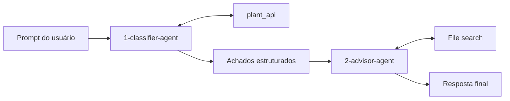

# Desafio 4: Construir um workflow visual

Tempo: ~25 minutos

## Objetivos

Ao final deste desafio, você terá:

- ✅ Um workflow visual no portal que conecta o Classificador ao Advisor
- ✅ A saída do classificador passando como entrada do advisor, sem copiar e colar
- ✅ Um trace completo do workflow, com os dois agentes e a ferramenta OpenAPI

## Contexto

Até aqui você testou cada agente separadamente e copiou os achados do Classificador para o Advisor manualmente. Em produção, essa passagem precisa ser automática. Um **workflow** no Foundry orquestra os agentes em sequência: a saída de um nó vira a entrada do próximo.

A passagem visual preserva a separação entre a classificação das medições e a recomendação de ações:



O Classificador lê os dados reais da planta pela ferramenta `plant_api` e produz a tabela de classificação. O Advisor recebe essa tabela e a transforma em ações, urgência e escalonamento, consultando os documentos da planta (procedimentos, SLAs e histórico) pela ferramenta **File search**.

---

## Etapa 1 — Criar o workflow

1. Abra [ai.azure.com/nextgen](https://ai.azure.com/nextgen) e selecione o seu projeto.
2. Na navegação superior, selecione **Build** → **Workflows** → **+ New workflow**.
3. Dê ao workflow o nome:

   ```text
   smart-industry-workflow
   ```

## Etapa 2 — Adicionar o nó do Classificador

1. Adicione um nó **Agent**.
2. Selecione o agente `1-classifier-agent`.


## Etapa 3 — Adicionar o nó do Advisor

1. Adicione um nó **Agent**.
2. Selecione o agente `2-advisor-agent`.
3. Conecte **classify → advise**.
4. Use o seletor de variáveis do portal para inserir a saída do classificador neste modelo de entrada do advisor:

   ```text
   Use somente estes achados do classificador:
   <classifier_findings>
   {{classify.output}}
   </classifier_findings>
   Forneça ações, urgência e escalonamento.
   ```

   A expressão exata pode variar conforme a versão do portal; selecione a saída de `classify` no seletor de variáveis em vez de digitar uma expressão não suportada.

> [!NOTE]
> O modelo diz ao Advisor para usar **somente** os achados recebidos. Isso reforça o guardrail do Desafio 1: o Advisor não inventa leituras nem reclassifica máquinas.

## Etapa 4 — Finalizar e executar

1. Conecte **advise → End** e salve o workflow.
2. Execute o workflow com:

   ```text
   Analise todas as máquinas da planta usando os dados atuais da ferramenta e, em seguida, recomende ações de manutenção.
   ```

## Etapa 5 — Inspecionar a execução

1. Abra os detalhes da execução e confirme que:
   - `classify` chamou a ferramenta `plant_api` (`list_machines`) e produziu a tabela com **2 máquinas críticas (INJ-002 e ROB-003), 3 altas (CNC-003, CVY-003 e FKL-003) e 11 baixas**
   - essa tabela foi passada para `advise`
   - a saída final exige **parada controlada e escalonamento imediato para a manutenção** na INJ-002 e a **verificação do gateway/sensor** na ROB-003, sem leituras inventadas
2. Abra **Observability** → **Tracing** e inspecione o trace completo do workflow: as duas etapas de agentes e a chamada à ferramenta OpenAPI.

> [!TIP]
> Se o `classify` pedir leituras em vez de chamar a ferramenta, a ferramenta `plant_api` não está anexada ao `1-classifier-agent` ou a URL da API está inacessível. Revise a Etapa 2 do Desafio 1.

---

## Critérios de sucesso

- [ ] Start → classify → advise → End está conectado
- [ ] A ferramenta OpenAPI do classificador é invocada
- [ ] O advisor usa a saída do classificador e não inventa leituras
- [ ] Cada passagem é visível nos detalhes da execução

Próximo: [Encerramento](../wrapup.md)
